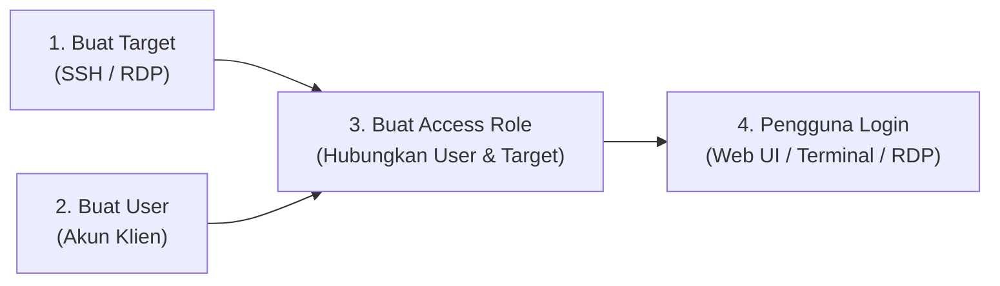

# 📖 Panduan Lengkap Administrasi Warpgate (v0.28.6)
### Setup Menu Admin UI & Konfigurasi Host Target (SSH & RDP)

Dokumen ini berisi panduan komprehensif mengenai fungsi seluruh menu pada Web Admin Warpgate serta tutorial langkah demi langkah mengonfigurasi mesin target (Linux untuk SSH & Windows untuk RDP) agar dapat diakses secara aman melalui Warpgate Bastion.

---

## 📑 Daftar Isi
1. [Struktur & Penjelasan Menu Web Admin](#1-struktur--penjelasan-menu-web-admin)
   - [Status](#-status)
   - [Config & Global Parameters](#-config--global-parameters)
   - [Log & Audit](#-log)
   - [Targets & Target Groups](#-targets--target-groups)
   - [Users & Access Roles](#-users--access-roles)
   - [Admin Roles](#-admin-roles)
   - [Tickets](#-tickets)
   - [SSH Keys & Known Hosts](#-ssh-keys--known-hosts)
   - [LDAP Servers](#-ldap-servers)
2. [Konfigurasi Mesin Target Linux (SSH)](#2-konfigurasi-mesin-target-linux-ssh)
   - [Memasang Public Key Warpgate ke authorized_keys](#memasang-public-key-warpgate-ke-authorized_keys)
   - [Script Otomatisasi Penambahan Key](#script-otomatisasi-penambahan-key)
   - [Verifikasi SSH Server di Target](#verifikasi-ssh-server-di-target)
3. [Konfigurasi Mesin Target Windows (RDP)](#3-konfigurasi-mesin-target-windows-rdp)
   - [Mengaktifkan Remote Desktop & Firewall](#mengaktifkan-remote-desktop--firewall)
   - [Mengaktifkan Fitur RDP di Warpgate](#mengaktifkan-fitur-rdp-di-warpgate)
4. [Langkah Demi Langkah (Workflow) di Admin UI](#4-langkah-demi-langkah-workflow-di-admin-ui)
   - [Langkah 1: Menambahkan Target](#langkah-1-menambahkan-target)
   - [Langkah 2: Menambahkan Pengguna (User)](#langkah-2-menambahkan-pengguna-user)
   - [Langkah 3: Membuat & Menghubungkan Access Role](#langkah-3-membuat--menghubungkan-access-role)
5. [Cara Mengakses Target (Koneksi Pengguna)](#5-cara-mengakses-target-koneksi-pengguna)
   - [Via Browser (Web Terminal & Web GUI)](#a-via-browser-web-client)
   - [Via Terminal SSH Klien](#b-via-terminal-ssh-klien)
   - [Via RDP Client (Remote Desktop)](#c-via-rdp-client-mstsc--remmina)

---

## 1. Struktur & Penjelasan Menu Web Admin

Di bilah navigasi kiri (*sidebar*) Warpgate v0.28.6, terdapat menu utama berikut:

### 📊 Status
- **Fungsi**: Dasbor pemantauan sesi aktif secara *real-time*.
- **Kegunaan**:
  - Melihat siapa saja pengguna yang sedang terhubung ke target server saat ini.
  - Memantau durasi sesi koneksi, IP sumber klien, serta target yang sedang diakses.
  - Opsi untuk memutuskan (*terminate/kill*) sesi yang mencurigakan atau sudah tidak aktif.

### ⚙️ Config & Global Parameters
- **Config**: Tampilan ringkasan arsitektur konfigurasi Warpgate yang sedang aktif.
- **Global Parameters**:
  - Pengaturan instance secara global seperti:
    - Batas waktu ketidakaktifan (*inactivity timeout*).
    - Maksimal durasi sesi (*max session lifetime*).
    - Format log & retensi penyimpanan rekaman (*session recording*).
    - Domain publik (*external host/port*) untuk URL akses pengguna.

### 📜 Log
- **Fungsi**: Rekam jejak audit (*audit trail*) dan riwayat aktivitas koneksi.
- **Kegunaan**:
  - Menampilkan riwayat login sukses dan gagal.
  - **Session Recording Player**: Memutar ulang rekaman video terminal SSH atau sesi RDP/Web dari koneksi masa lalu untuk kebutuhan forensik dan audit keamanan.

### 👤 Admin (User Profile)
- Profil akun administrator yang sedang login.
- Digunakan untuk mengubah password akun admin, mengaktifkan autentikasi 2 faktor (TOTP / Google Authenticator), atau Logout.

### 🎯 Targets & Target Groups
- **Targets (Destinations for users to connect to)**:
  - Tempat mendaftarkan server tujuan (Linux VM, Windows Server, Database MySQL/Postgres, Kubernetes, atau Web internal).
  - Berisi konfigurasi: Nama target, tipe protokol (`ssh`, `rdp`, `mysql`, `postgres`, `http`), IP/hostname upstream, port tujuan, serta metode autentikasi upstream.
- **Target groups (Organize targets into groups)**:
  - Pengelompokan beberapa target ke dalam satu grup logis.
  - *Contoh*: Grup `Production-Linux`, `Staging-Servers`, `Office-Windows-PCs`. Memudahkan pemberian izin sekaligus tanpa perlu memilih server satu per satu.

### 👥 Users & Access Roles
- **Users (Manage accounts and credentials)**:
  - Manajemen akun pengguna yang diizinkan masuk ke Warpgate Bastion.
  - Anda dapat menentukan username, password Warpgate, SSH Public Key pribadi pengguna (jika pengguna ingin login ke Warpgate dengan SSH key mereka sendiri), dan OTP/2FA.
- **Access roles (Grant users access to roles)**:
  - Matriks perizinan (Access Control List / RBAC).
  - Menghubungkan **Siapa (Users/User Groups)** dapat mengakses **Apa (Targets/Target Groups)**.
  - *Contoh*: Role `Backend-Dev` memberikan akses kepada user `budi` dan `ani` hanya ke target group `Staging-Servers`.

### 🛡️ Admin Roles
- **Fungsi**: Mengatur hak akses ke antarmuka Admin UI Warpgate.
- **Kegunaan**: Jika Anda memiliki tim infrastruktur lain yang butuh mengelola target atau melihat log tanpa memberikan akses penuh *superadmin*, Anda dapat membuat role khusus di menu ini.

### 🎫 Tickets
- **Fungsi**: Kredensial sementara (*Temporary access credentials / One-time access link*).
- **Kegunaan**: Digunakan jika Anda ingin memberikan akses darurat kepada vendor atau teknisi pihak ketiga tanpa harus membuatkan akun permanen. Tiket memiliki masa berlaku (misal: 2 jam) dan otomatis hangus setelah kedaluwarsa.

### 🔑 SSH Keys & Known Hosts
- **Own keys (Warpgate Client Keys)**:
  Kunci publik milik Warpgate yang **wajib dipasang di server target**. Ketika pengguna masuk ke target lewat Warpgate, Warpgate akan bertindak sebagai klien SSH dan mengautentikasi ke target menggunakan salah satu kunci ini.
  
  Berdasarkan instance Anda:
  1. `client-ed25519` (Rekomendasi - sangat cepat & aman):
     ```text
     ssh-ed25519 AAAAC3NzaC1lZDI1NTE5AAAAIPP9jSmG5RFgu7o707PR+m8+SODj3neKntOxJitTSXiH
     ```
  2. `client-rsa` (Alternatif jika target OS legacy hanya mendukung RSA):
     ```text
     ssh-rsa AAAAB3NzaC1yc2EAAAADAQABAAACAQC/RIROapJJOsStr6ugI4iX5KqZxJe2TlWRmdZ/v31PXtVWBRbeD5HBas8TfVhM8Z0ObVdl/K6wK78PvDwK//FloNyvTyhlL7OygATsJOzGw0HJVjf4MThX+tIbEktOWG77uTXGSV1E+m1dRu8CW3FMs7XPmdSkA3Y2MWfWy8lScAEI5Z90z7sUOCl7eqUbqbn3J7dv7Kw7J/Lk1vPKySlygQ68dymnhNX6fMwbst4wm9Htb/50dyzVkeCSGkaQny5khGp4llCWAXwtp4ZsMHJxNvfSuYSuf6efjqn87Y5sli3kgG6y3pLOpQzzq4qaoyBpDMeL4gN4kQsKD7riFNU7H4/uK9VnYTF6Nnexa0nvTgRJO4nv9GYfhPlhrOW8S+Pi8q8fm6+KK1F9bezTV4kACv2RQ2UB1g52/Kh9u3YD9W5Rax/Mp3Gg3Hbr1v65YgJxtETwLiS7IgFsVA+oF9C4UILN03a3ftdj/qko2ULCENxrSq59QncHW3GTQra8cNaP7LEzvQUEpmLGah/iSAe5Uclxb8OveYGyn+5EJ/xJFpPr23IqmeMXl6AsQ3LxX7ezSp6VUH3aEXQ7fgbgfwc2+29JRvNKumwKvKbQALIz8r6HiKsDSy3qOJvdU2RjX9SAzOxx1REA7X2mXLKrxWSla194Gk7T4Nlkl9tWIE3eQw==
     ```
  3. `harpa` (Kunci kustom tambahan yang terdaftar):
     ```text
     ssh-ed25519 AAAAC3NzaC1lZDI1NTE5AAAAIMG1lq1/wCMl+BvuHjo9QeFFOpr2j1TaYcxVWymhXxiw
     ```
- **Known hosts**:
  Daftar fingerprint SSH dari target yang sudah pernah diverifikasi oleh Warpgate (mencegah serangan Man-In-The-Middle / MITM):
  - `10.10.10.152:22`
  - `10.10.0.125:22`
  - `10.10.20.7:22`
  - `10.10.30.196:22`

### 🏢 LDAP Servers
- **Fungsi**: Integrasi dengan layanan direktori terpusat seperti Microsoft Active Directory (AD), FreeIPA, atau OpenLDAP.
- **Kegunaan**: Memungkinkan user login ke Warpgate menggunakan akun domain perusahaan yang sudah ada.

---

## 2. Konfigurasi Mesin Target Linux (SSH)

Agar Warpgate dapat melakukan koneksi SSH ke server target (seperti `10.10.10.152`, `10.10.0.125`, dll), **Public Key Warpgate** harus dimasukkan ke dalam file `~/.ssh/authorized_keys` di masing-masing server target.

### Memasang Public Key Warpgate ke `authorized_keys`

Pilih user target di server tujuan yang akan digunakan (misalnya `root`, `ubuntu`, `debian`, `ec2-user`, atau `opc`).

Masuk ke server target, lalu jalankan perintah berikut:

```bash
# 1. Pastikan folder ~/.ssh ada dan permission benar
mkdir -p ~/.ssh
chmod 700 ~/.ssh

# 2. Masukkan public key ed25519 milik Warpgate
echo "ssh-ed25519 AAAAC3NzaC1lZDI1NTE5AAAAIPP9jSmG5RFgu7o707PR+m8+SODj3neKntOxJitTSXiH warpgate-client-ed25519" >> ~/.ssh/authorized_keys

# 3. Kunci permission file authorized_keys
chmod 600 ~/.ssh/authorized_keys
```

> [!TIP]
> Jika server target Anda adalah distro Linux lama yang belum mendukung `ed25519`, gunakan kunci `client-rsa`:
> ```bash
> echo "ssh-rsa AAAAB3NzaC1yc2EAAAADAQABAAACAQC/RIROapJJOsStr6ugI4iX5KqZxJe2TlWRmdZ/v31PXtVWBRbeD5HBas8TfVhM8Z0ObVdl/K6wK78PvDwK//FloNyvTyhlL7OygATsJOzGw0HJVjf4MThX+tIbEktOWG77uTXGSV1E+m1dRu8CW3FMs7XPmdSkA3Y2MWfWy8lScAEI5Z90z7sUOCl7eqUbqbn3J7dv7Kw7J/Lk1vPKySlygQ68dymnhNX6fMwbst4wm9Htb/50dyzVkeCSGkaQny5khGp4llCWAXwtp4ZsMHJxNvfSuYSuf6efjqn87Y5sli3kgG6y3pLOpQzzq4qaoyBpDMeL4gN4kQsKD7riFNU7H4/uK9VnYTF6Nnexa0nvTgRJO4nv9GYfhPlhrOW8S+Pi8q8fm6+KK1F9bezTV4kACv2RQ2UB1g52/Kh9u3YD9W5Rax/Mp3Gg3Hbr1v65YgJxtETwLiS7IgFsVA+oF9C4UILN03a3ftdj/qko2ULCENxrSq59QncHW3GTQra8cNaP7LEzvQUEpmLGah/iSAe5Uclxb8OveYGyn+5EJ/xJFpPr23IqmeMXl6AsQ3LxX7ezSp6VUH3aEXQ7fgbgfwc2+29JRvNKumwKvKbQALIz8r6HiKsDSy3qOJvdU2RjX9SAzOxx1REA7X2mXLKrxWSla194Gk7T4Nlkl9tWIE3eQw== warpgate-client-rsa" >> ~/.ssh/authorized_keys
> chmod 600 ~/.ssh/authorized_keys
> ```

### Script Otomatisasi Penambahan Key

Jika Anda memiliki akses SSH langsung sementara dari laptop/komputer admin ke IP target, Anda dapat mengirimkan key tersebut dengan perintah `ssh-copy-id`:

```bash
# Simpan key ke file sementara di laptop Anda
echo "ssh-ed25519 AAAAC3NzaC1lZDI1NTE5AAAAIPP9jSmG5RFgu7o707PR+m8+SODj3neKntOxJitTSXiH warpgate" > /tmp/warpgate.pub

# Kirim ke masing-masing target
ssh-copy-id -i /tmp/warpgate.pub ubuntu@10.10.10.152
ssh-copy-id -i /tmp/warpgate.pub ubuntu@10.10.0.125
ssh-copy-id -i /tmp/warpgate.pub ubuntu@10.10.20.7
ssh-copy-id -i /tmp/warpgate.pub ubuntu@10.10.30.196
```

### Verifikasi SSH Server di Target
Pastikan pada `/etc/ssh/sshd_config` server target:
- `PubkeyAuthentication yes`
- Port SSH standar `22` (atau sesuai konfigurasi target Anda)
- Jalankan `sudo systemctl reload sshd` jika melakukan perubahan.

---

## 3. Konfigurasi Mesin Target Windows (RDP)

Warpgate mendukung koneksi proxy RDP (Remote Desktop Protocol) baik via browser maupun native RDP client.

### Mengaktifkan Remote Desktop & Firewall

1. **Aktifkan Remote Desktop**:
   - Buka **Settings** > **System** > **Remote Desktop**.
   - Ubah toggle **Enable Remote Desktop** menjadi **On**.
2. **Atur Hak Akses Pengguna**:
   - Klik **Select users that can remotely access this PC**.
   - Masukkan user Windows yang diizinkan (misal: user lokal `Administrator` atau akun Domain).
3. **Firewall Windows**:
   - Pastikan port **3389 TCP/UDP** diizinkan pada Windows Firewall untuk subnet Warpgate (atau jalankan PowerShell as Admin):
     ```powershell
     Enable-NetFirewallRule -DisplayGroup "Remote Desktop"
     ```
4. **Network Level Authentication (NLA)**:
   - Warpgate v0.28+ mendukung NLA (CredSSP). Pastikan username dan password Windows target diketahui saat menambahkan target di Warpgate.

### Mengaktifkan Fitur RDP di Warpgate

Secara bawaan di `data/warpgate.yaml`, port RDP belum aktif. Jika Anda ingin klien menghubungkan aplikasi RDP native (`mstsc.exe`):

1. Edit `data/warpgate.yaml`:
   ```yaml
   rdp:
     enable: true
     listen: '[::]:3389'
   ```
2. Tambahkan port `3389:3389` pada file `docker-compose.yml`:
   ```yaml
   ports:
     - "2222:2222"   # SSH
     - "8889:8888"   # Admin UI
     - "3389:3389"   # RDP Proxy
     - "33306:33306" # MySQL
     - "55432:55432" # Postgres
   ```
3. Restart Warpgate:
   ```bash
   docker compose restart warpgate
   ```

*(Catatan: Jika pengguna hanya akan mengakses RDP melalui Web Browser via Web Client Warpgate di port 8889, Anda tidak wajib mengekspos port 3389 ke publik).*

---

## 4. Langkah Demi Langkah (Workflow) di Admin UI

Berikut alur registrasi target dan pemberian hak akses di panel admin Warpgate:



### Langkah 1: Menambahkan Target
1. Masuk ke Web Admin Warpgate (`https://<IP-WARPGATE>:8889`).
2. Masuk ke menu **Targets** di panel kiri, lalu klik tombol **+ Add target**.
3. Isi parameter target:
   - **Name**: Beri nama yang jelas, contoh: `server-db-10-10-10-152` atau `windows-ad-server`.
   - **Target Kind**:
     - Pilih **SSH** untuk server Linux.
     - Pilih **RDP** untuk server Windows.
   - **Host & Port**:
     - Masukkan IP address host (contoh: `10.10.10.152`) dan Port (contoh: `22` untuk SSH, `3389` untuk RDP).
   - **Authentication**:
     - **Untuk SSH**:
       - *Username*: Masukkan username default server target (misal `ubuntu`, `root`, atau kosongkan jika ingin user memasukkannya sendiri).
       - *Auth Method*: Pilih **Public key (Warpgate key)** -> pilih `client-ed25519`.
     - **Untuk RDP**:
       - *Username & Password*: Masukkan kredensial Windows atau biarkan meminta ke pengguna (*Prompt user*).
       - *TLS/Security*: Atur verifikasi sertifikat sesuai kebutuhan.
4. Klik **Save**.
5. *(Opsional)* Kelompokkan target di menu **Target groups** jika server berjumlah banyak.

### Langkah 2: Menambahkan Pengguna (User)
1. Masuk ke menu **Users** di panel kiri, lalu klik **+ Add user**.
2. Masukkan **Username** (contoh: `andi`).
3. Tentukan autentikasi:
   - **Password**: Buat password login untuk pengguna tersebut ke Warpgate.
   - **SSH Public Key**: (Opsional) Jika pengguna ingin login ke Warpgate via terminal tanpa mengetik password, masukkan public key laptop pengguna di sini.
   - **2FA/TOTP**: (Opsional) Aktifkan jika mewajibkan verifikasi OTP Google Authenticator.
4. Klik **Save**.

### Langkah 3: Membuat & Menghubungkan Access Role
Pengguna **tidak akan bisa mengakses target** sebelum diberikan peran (*Access Role*):
1. Masuk ke menu **Access roles** di panel kiri, klik **+ Add role**.
2. Masukkan nama role, contoh: `DevOps-FullAccess`.
3. Di bagian **Users**, pilih user yang telah dibuat (misal: `andi`).
4. Di bagian **Targets**, pilih target atau grup target yang diizinkan (misal: `server-db-10-10-10-152`).
5. Klik **Save**.

---

## 5. Cara Mengakses Target (Koneksi Pengguna)

Setelah setup selesai, pengguna dapat terhubung melalui beberapa cara:

### A. Via Browser (Web Client)
1. Buka browser dan arahkan ke alamat Warpgate: `https://<IP-WARPGATE>:8889`.
2. Login dengan akun user (bukan akun admin, misal: user `andi`).
3. Pengguna akan langsung melihat daftar target yang diizinkan.
4. Klik **Connect**:
   - Untuk SSH: Membuka terminal interaktif langsung di dalam tab browser.
   - Untuk RDP: Membuka sesi GUI desktop Windows interaktif di dalam browser tanpa perlu software tambahan!

### B. Via Terminal SSH Klien
Pengguna dapat menggunakan terminal bawaan (macOS/Linux/WSL) atau PuTTY dengan port **2222**:

```bash
# Opsi 1: Masuk dengan Interactive Target Picker (akan muncul menu pilihan server)
ssh andi@<IP-WARPGATE> -p 2222

# Opsi 2: Langsung menuju target tertentu (format: username:target_name@warpgate)
ssh andi:server-db-10-10-10-152@<IP-WARPGATE> -p 2222
```

### C. Via RDP Client (`mstsc` / Remmina)
Jika port 3389 diaktifkan pada Warpgate:
1. Buka aplikasi **Remote Desktop Connection** (`mstsc.exe`).
2. Masukkan komputer: `<IP-WARPGATE>:3389`.
3. Pada saat login, gunakan username dengan format:
   ```text
   <username-warpgate>:<target-name>
   Contoh: andi:windows-ad-server
   ```
4. Masukkan password akun Warpgate Anda. Warpgate akan meneruskan sesi ke Windows target secara otomatis.

---

## 📌 Ringkasan Checklist

| Komponen | Hal yang Harus Dicek |
| :--- | :--- |
| **Linux Target (SSH)** | Public key `client-ed25519` Warpgate sudah ada di `~/.ssh/authorized_keys` dengan permission `600`. |
| **Windows Target (RDP)** | Remote Desktop aktif, port 3389 terbuka di Firewall, user Windows memiliki hak remote. |
| **Warpgate Targets** | Target sudah didaftarkan dengan IP/Port yang benar dan auth yang sesuai. |
| **Warpgate Users** | Akun pengguna sudah dibuat dengan password/credential. |
| **Access Roles** | User sudah dipetakan ke Target pada menu Access Roles. |
