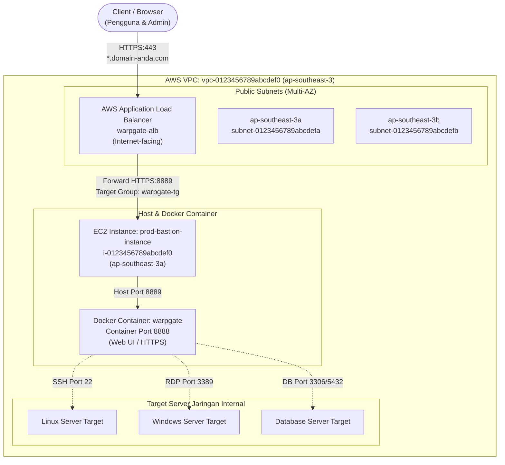

# 🌐 Panduan Konfigurasi AWS Application Load Balancer (ALB) — Warpgate

Dokumen ini berisi dokumentasi teknis, arsitektur, parameter konfigurasi, serta panduan operasional untuk **AWS Application Load Balancer (ALB)** dan **Target Group** yang digunakan pada instance **Warpgate Bastion**.

> [!NOTE]
> Nilai identifier seperti AWS Account ID, VPC ID, Subnet ID, Instance ID, dan Domain Name pada panduan ini disamarkan (*sanitized*) menggunakan format placeholder standar sehingga aman digunakan sebagai template umum (publik/produksi).

---

## 📑 Daftar Isi
1. [Arsitektur & Diagram Alur Lalu Lintas](#1-arsitektur--diagram-alur-lalu-lintas)
2. [Spesifikasi AWS Application Load Balancer (ALB)](#2-spesifikasi-aws-application-load-balancer-alb)
3. [Konfigurasi Listener & Sertifikat SSL/TLS](#3-konfigurasi-listener--sertifikat-ssltls)
4. [Spesifikasi Target Group & Konfigurasi Target](#4-spesifikasi-target-group--konfigurasi-target)
5. [Konfigurasi Health Check (Kritis)](#5-konfigurasi-health-check-kritis)
6. [Mapping Port & Alur Trafik Protokol](#6-mapping-port--alur-trafik-protokol)
7. [Security Group & Aturan Firewall](#7-security-group--aturan-firewall)
8. [Integrasi dengan Konfigurasi Warpgate (`warpgate.yaml`)](#8-integrasi-dengan-konfigurasi-warpgate-warpgateyaml)
9. [Troubleshooting & Solusi Masalah](#9-troubleshooting--solusi-masalah)

---

## 1. Arsitektur & Diagram Alur Lalu Lintas

Warpgate Web Admin UI dan Web Client (Terminal & Web RDP) diekspos ke publik secara aman melalui AWS Application Load Balancer (ALB) dengan terminasi SSL/TLS menggunakan sertifikat ACM wildcard `*.domain-anda.com`.



---

## 2. Spesifikasi AWS Application Load Balancer (ALB)

Berikut rincian resource AWS ALB:

| Parameter | Nilai Konfigurasi (Template Disamarkan) | Keterangan |
| :--- | :--- | :--- |
| **Nama Load Balancer** | `warpgate-alb` | Nama resource ALB di AWS Management Console |
| **Tipe Load Balancer** | `Application` (ALB) | Layer 7 Load Balancer (HTTP/HTTPS) |
| **Scheme** | `Internet-facing` | Dapat diakses melalui jaringan publik / internet |
| **Status** | `Active` | Beroperasi normal |
| **AWS Region** | `ap-southeast-3` (Jakarta) | Sesuaikan dengan region AWS Anda |
| **VPC ID** | `vpc-0123456789abcdef0` | Virtual Private Cloud tempat ALB berada |
| **Hosted Zone ID** | `Z1234567890EXAMPLE` | Canonical Hosted Zone ID milik ALB |
| **Load Balancer ARN** | `arn:aws:elasticloadbalancing:ap-southeast-3:123456789012:loadbalancer/app/warpgate-alb/46f2d6b41b697bd6` | Format ARN AWS standar |
| **DNS Name (A Record)**| `warpgate-alb-1234567890.ap-southeast-3.elb.amazonaws.com` | Hostname publik bawaan AWS ALB |
| **IP Address Type** | `IPv4` | Alokasi alamat IPv4 |
| **Availability Zones** | • `ap-southeast-3a` (`apse3-az1`): `subnet-0123456789abcdefa`<br>• `ap-southeast-3b` (`apse3-az2`): `subnet-0123456789abcdefb` | High-availability multi-subnet deployment |

---

## 3. Konfigurasi Listener & Sertifikat SSL/TLS

ALB menangani enkripsi SSL publik di layer terdepan (*SSL Termination* / *Offloading*).

### Rincian Listener

| Atribut | Pengaturan |
| :--- | :--- |
| **Protokol : Port** | `HTTPS : 443` |
| **Default Action** | Forward to target group `warpgate-tg` (Bobot: 1 / 100%) |
| **Target Group Stickiness** | `Off` |
| **Security Policy** | `ELBSecurityPolicy-TLS13-1-2-Res-PQ-2025-09` *(TLS 1.3 & TLS 1.2 modern dengan dukungan cipher Post-Quantum Hybrid / Resilient)* |
| **Default SSL/TLS Certificate**| `*.domain-anda.com` (ACM Certificate ID: `0b38825c-xxxx-xxxx-xxxx-xxxxxxxxxxxx`) |
| **Mutual TLS (mTLS)** | `Off` |
| **Trust Store** | Not applicable |

> [!TIP]
> **Domain Penggunaan:**  
> Arahkan CNAME atau Alias Record Route 53 (misalnya `bastion.domain-anda.com` atau `warpgate.domain-anda.com`) ke DNS name ALB:  
> `warpgate-alb-1234567890.ap-southeast-3.elb.amazonaws.com`

---

## 4. Spesifikasi Target Group & Konfigurasi Target

Target Group mengarahkan lalu lintas dari port HTTPS 443 ALB menuju port HTTPS 8889 pada instance Bastion.

| Parameter | Nilai Konfigurasi | Keterangan |
| :--- | :--- | :--- |
| **Nama Target Group** | `warpgate-tg` | Nama grup target di AWS EC2 |
| **ARN Target Group** | `arn:aws:elasticloadbalancing:ap-southeast-3:123456789012:targetgroup/warpgate-tg/c901a3c90df24594` | ARN Resource |
| **Target Type** | `Instance` | Mendaftarkan EC2 Instance secara langsung |
| **Protokol : Port** | `HTTPS : 8889` | Protokol dan port yang diterima oleh host |
| **Protocol Version** | `HTTP1` | Kompatibilitas dengan upstream Warpgate HTTP server |
| **VPC** | `vpc-0123456789abcdef0` | VPC yang sama dengan ALB & EC2 |
| **IP Address Type** | `IPv4` | |

### Registered Targets

| Instance ID | Nama Host (Tag) | Port | Availability Zone | Status Health | Anomaly Detection |
| :--- | :--- | :---: | :--- | :---: | :---: |
| `i-0123456789abcdef0` | `prod-bastion-instance` | `8889` | `ap-southeast-3a` (`apse3-az1`) | `Healthy` ✅ | `Normal` |

---

## 5. Konfigurasi Health Check (Kritis)

Pengaturan Health Check sangat krusial agar instance Warpgate tidak ditandai sebagai `Unhealthy` oleh AWS ALB.

| Parameter Health Check | Pengaturan | Penjelasan Penting |
| :--- | :---: | :--- |
| **Protocol** | `HTTPS` | Warpgate Web UI secara default melayani HTTPS mandiri (TLS internal) |
| **Path** | `/` | Endpoint root web Warpgate |
| **Port** | `Traffic port` (`8889`) | Memeriksa port layanan aplikasi |
| **Healthy threshold** | `4` consecutive successes | Membutuhkan 4 kali pengecekan berturut-turut untuk menandai Healthy |
| **Unhealthy threshold** | `2` consecutive failures | Menandai Unhealthy setelah 2 kali kegagalan |
| **Timeout** | `5 seconds` | Waktu tunggu respons sebelum dinyatakan timeout |
| **Interval** | `30 seconds` | Jeda waktu antara pengecekan |
| **Success codes** | **`200-401`** | ⭐ **Sangat Penting!** *(Lihat catatan di bawah)* |

> [!IMPORTANT]
> ### ⚠️ Mengapa Success Codes Harus `200-401`?
> Secara default, halaman login Warpgate pada root path `/` akan mengembalikan respons status HTTP **`401 Unauthorized`** (atau `200 OK` / `302 Found` tergantung sesi browser).  
> Jika AWS ALB Health Check hanya diset dengan kode standar `200`, maka respons `401` dari Warpgate akan dianggap sebagai *kegagalan*, sehingga status target menjadi **`Unhealthy`** dan ALB akan mengembalikan error `502 Bad Gateway`.  
> Dengan menyetel Success Codes ke **`200-401`**, ALB mengenali bahwa server Warpgate aktif dan merespons dengan benar.

---

## 6. Mapping Port & Alur Trafik Protokol

Warpgate mendukung berbagai protokol (Web, SSH, Database, RDP). Karena ALB adalah **Layer 7 (HTTP/HTTPS)**, ada perbedaan cara akses untuk setiap layanan:

```text
                  ┌──► Port 443 (HTTPS) ──► ALB: warpgate-alb ──► Host: 8889 ──► Container: 8888 (Web UI & Terminal)
                  │
Pengguna Luar ────┼──► Port 2222 (SSH) ────────► Langsung ke IP Publik / NLB ──► Host: 2222 (SSH Bastion)
                  │
                  ├──► Port 33306 (MySQL) ──────► Langsung ke IP Publik / NLB ──► Host: 33306 (MySQL Proxy)
                  │
                  └──► Port 55432 (Postgres) ───► Langsung ke IP Publik / NLB ──► Host: 55432 (PG Proxy)
```

| Layanan | Port Publik | Perantara | Port Host EC2 | Port Container | Keterangan |
| :--- | :---: | :---: | :---: | :---: | :--- |
| **Web Admin & Web Terminal** | `443` | **AWS ALB** (`warpgate-alb`) | `8889` | `8888` | Akses via browser: `https://bastion.domain-anda.com` |
| **SSH Bastion** | `2222` | Direct / NLB | `2222` | `2222` | Akses via SSH client: `ssh -p 2222 user#target@<IP-EC2>` |
| **MySQL Proxy** | `33306` | Direct / NLB | `33306` | `33306` | Akses via MySQL GUI / CLI |
| **PostgreSQL Proxy** | `55432` | Direct / NLB | `55432` | `55432` | Akses via psql / DBeaver |

---

## 7. Security Group & Aturan Firewall

Pastikan Security Group di AWS dikonfigurasi dengan relasi sebagai berikut:

### 1. Security Group untuk ALB (`sg-alb-warpgate`)
- **Inbound Rules:**
  - `HTTPS (443)`: Dari `0.0.0.0/0` (atau batasi hanya IP VPN / Kantor jika ingin privat).
- **Outbound Rules:**
  - `Custom TCP (8889)`: Diarahkan ke Security Group EC2 Bastion (`sg-ec2-bastion`).

### 2. Security Group untuk EC2 Bastion (`sg-ec2-bastion`)
- **Inbound Rules:**
  - `Custom TCP (8889)`: Izinkan HANYA dari Security Group ALB (`sg-alb-warpgate`). Jangan dibuka ke `0.0.0.0/0` agar tidak membocorkan port internal.
  - `Custom TCP (2222)`: Izinkan dari IP tim / developer yang membutuhkan akses SSH Bastion.
  - `SSH (22)`: Port SSH manajemen internal host EC2 (akses sysadmin).
  - `Custom TCP (33306 & 55432)`: Jika database proxy dibuka ke luar.
- **Outbound Rules:**
  - `SSH (22)`: Ke IP/Subnet target Linux yang akan dikelola.
  - `RDP (3389)`: Ke IP/Subnet target Windows Server yang akan dikelola.
  - `MySQL (3306)` & `Postgres (5432)`: Ke database internal target.

---

## 8. Integrasi dengan Konfigurasi Warpgate (`warpgate.yaml`)

File konfigurasi Warpgate di host (`data/warpgate.yaml`) telah disesuaikan agar bekerja optimal di belakang reverse proxy / ALB:

```yaml
# Pada bagian http di data/warpgate.yaml:
http:
  listen: '[::]:8888'
  proxy_protocol: false
  external_port: 443                    # Port publik yang dilihat pengguna
  external_host: bastion.domain-anda.com # Domain publik Anda
  certificate: /data/tls.certificate.pem
  key: /data/tls.key.pem
  trust_x_forwarded_headers: true       # Wajib TRUE agar Warpgate membaca IP asli klien dari ALB
  session_max_age: 30m
  cookie_max_age: 1day
```

> [!NOTE]
> Nilai `trust_x_forwarded_headers: true` memastikan bahwa:
> 1. Header `X-Forwarded-For` dari AWS ALB diteruskan ke audit log Warpgate sehingga IP asli klien tercatat dengan akurat.
> 2. Header `X-Forwarded-Proto` (`https`) diteruskan sehingga tautan sesi dan redirect internal tidak menghasilkan loop HTTP/HTTPS.

---

## 9. Troubleshooting & Solusi Masalah

### 1. Target Status Menjadi `Unhealthy`
- **Penyebab A: Success codes salah.**  
  Periksa pengaturan Health Check pada Target Group. Pastikan Success codes berisi **`200-401`**. Jika hanya `200`, Warpgate yang mengembalikan `401 Unauthorized` pada halaman root akan dinilai gagal.
- **Penyebab B: Container Warpgate tidak berjalan.**  
  Jalankan perintah di host:
  ```bash
  docker compose ps
  docker compose logs -f warpgate
  ```
- **Penyebab C: Security Group terblokir.**  
  Pastikan Inbound port `8889` pada EC2 mengizinkan koneksi dari Security Group ALB.

### 2. Sesi Web Terminal / Web RDP Sering Terputus Otomatis
- **Penyebab: ALB Idle Timeout terlalu pendek.**  
  Secara bawaan, AWS ALB memiliki Idle Timeout sebesar 60 detik. Untuk sesi Web Terminal dan Web RDP berbasis WebSocket, disarankan menaikkan atribut Idle Timeout ALB menjadi setidaknya `300` hingga `3600` detik (5 - 60 menit):
  - Masuk ke AWS Console > **Load Balancers** > Pilih Load Balancer Warpgate.
  - Buka tab **Attributes** > **Edit**.
  - Ubah **Idle timeout** menjadi `3600` detik.

### 3. Menguji Endpoint ALB Melalui CLI
Jalankan uji koneksi dari terminal lokal untuk memastikan respons ALB dan sertifikat SSL:

```bash
# Uji akses langsung ke domain ALB
curl -I https://warpgate-alb-1234567890.ap-southeast-3.elb.amazonaws.com

# Uji akses dengan SNI domain kustom
curl -Iv https://bastion.domain-anda.com
```
Respons yang diharapkan adalah status HTTP `200` atau `401 Unauthorized` dengan sertifikat SSL valid dari ACM.
